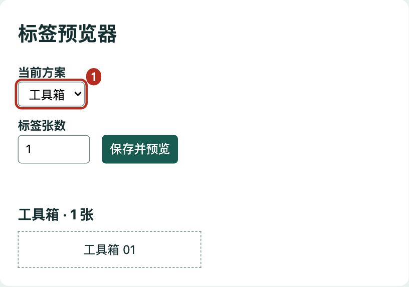
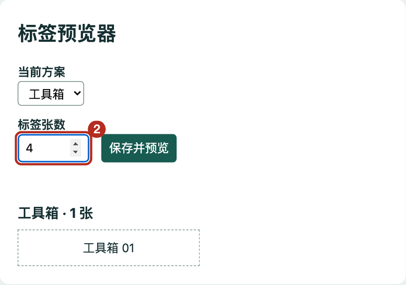
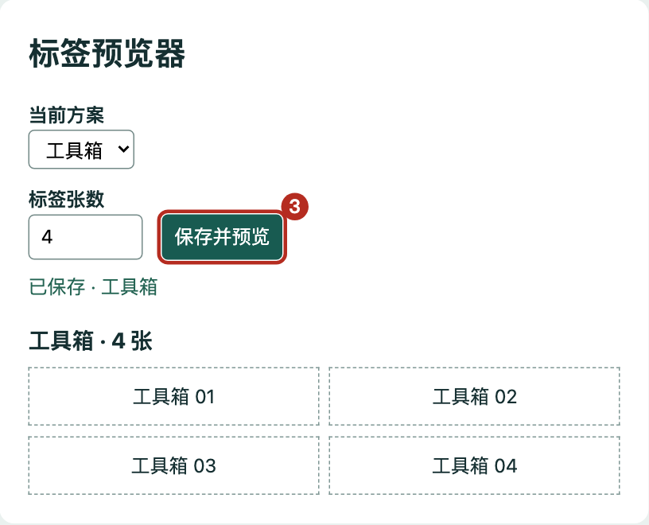

# 把「工具箱」的标签设为 4 张

适用本项目随附的[标签预览器](index.html)。下载项目后在浏览器打开 `examples/labels/index.html`。页面顶端应写着「标签预览器」。如果看到一屏代码，你还在 GitHub 文件页，请打开下载到电脑的 HTML 文件。

### ① 先选「工具箱」

点「当前方案」下拉框，选 **工具箱**。看下方预览标题，开头也应是「工具箱」。若仍显示「书架」，先把方案切对。

### ② 将张数改成 4

点「标签张数」，选中原数字，输入 **4**。此时输入框显示 4，下方预览仍显示上次保存的张数。

### ③ 保存，看见第四张

点 **保存并预览**。按钮下方应出现「已保存 · 工具箱」，预览标题应是「工具箱 · 4 张」，最后一格是「工具箱 04」。

**再验一次。** 切到「书架」，再切回「工具箱」。输入框应读出 4；「书架」仍保留它原来的张数。如果显示「仅本次预览，浏览器未保存」，先允许本页使用本地存储，再做第 ③ 步。

本例使用随项目发布的原创演示软件。图为浏览器实际运行截图，红框和编号用于对照步骤。示例只生成屏幕预览。
